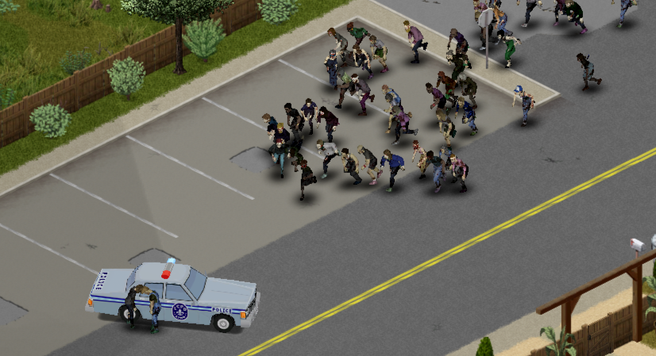

# Blind Sound Hunters

A **Project Zomboid Build 42** mod where every zombie is completely blind. They hunt by sound alone: noise sends them sprinting toward its source, silence leaves them shambling aimlessly, and only physical contact lets them lock onto you.



Stand still and quiet, and a horde can shuffle right past you. Fire a gun, smash a window or start a car, and every zombie in earshot comes running.

- **Requires:** Project Zomboid Build 42 (developed and tested on 42.22).
- **Tested in:** singleplayer. Multiplayer has not been tested and is not supported yet.
- **Languages:** English, Brazilian Portuguese.

## Installation

**Steam Workshop** *(recommended)*: subscribe to the mod on its Workshop page, then enable **Blind Sound Hunters** in the in-game **Mods** menu.

**Manual:**

1. Download this repository (or a release).
2. Copy the folder `Contents/mods/BlindSoundHunters` into your Zomboid user folder, so you end up with `Zomboid/mods/BlindSoundHunters/mod.info`.
   - Linux (native): `~/Zomboid/mods/`
   - Windows: `C:\Users\<you>\Zomboid\mods\`
   - Linux via Proton: `<Steam library>/steamapps/compatdata/108600/pfx/drive_c/users/steamuser/Zomboid/mods/`
3. Start the game, open **Mods**, enable **Blind Sound Hunters** and accept.
4. Create a new **Sandbox** game. The mod's settings are on the **Blind Sound Hunters** page.

## How it works

Every zombie is always in one of three states:

| State | Behavior |
|---|---|
| **Wandering** (blind) | Shambles slowly and takes short random walks. It cannot see you, even face to face. |
| **Alerted** (sprinting) | Heard a valid sound: becomes a sprinter and runs to where the sound came from (or walks there, if **Sprint Toward Sounds** is off). Louder and closer sounds take priority. It calms down on arrival, or after a while without new sounds. |
| **Tactile combat** | Bumped into you, or was hit or shoved by you: **only that zombie** locks onto you and attacks. To lose it, get farther than 1.8 tiles and stay completely silent for a moment. |

### What counts as a sound

Every world sound the game emits is considered: gunshots, engines, horns, sirens, alarms, breaking windows, generators, footsteps, shouting and so on.

- The sound needs a physical source. Sounds without one are ignored.
- Zombie noises (groans, thumping) never alert other zombies.
- A sound is ignored if its base radius is below **Minimum Sound Radius**. Otherwise its radius is multiplied by **Hearing Multiplier**.
- A zombie hears a sound only if it is inside that radius and within one floor of it.
- Among the sounds a zombie hears, it goes for the one with the highest `volume / distance`.
- Any sound you make, even a quiet one, breaks the silence needed to escape a zombie in tactile combat.

### Sandbox options

| Option | Default | Description |
|---|---|---|
| Hearing Multiplier | 1.0 (0.1–5.0) | Multiplies how far every sound reaches. |
| Minimum Sound Radius | 5 (0–100) | Sounds with a smaller base radius (in tiles) are ignored. |
| Zombie Strength | Superhuman | Strength of every zombie: Superhuman, Normal or Weak. |
| Sprint Toward Sounds | On | When on, alerted zombies sprint toward the sound. When off, they only walk toward it. |
| Alert Memory | 15 s (1–120) | How long an alerted zombie keeps chasing a sound before giving up. |
| Silence to Escape | 2 s (0–30) | How long you must be silent and at a distance to escape tactile combat. |

### Implementation notes

The code is in [`Contents/mods/BlindSoundHunters/42/media/lua`](Contents/mods/BlindSoundHunters/42/media/lua):

| File | Role |
|---|---|
| `shared/BSH_Config.lua` | Constants and sandbox option loading. |
| `client/BSH_SoundListener.lua` | `OnWorldSound` handler. Filters sounds and writes them into a preallocated ring buffer (no allocations). |
| `client/BSH_ZombieAI.lua` | The state machine, driven by `OnZombieUpdate`. |
| `client/BSH_CombatTactile.lua` | Hit, shove and contact detection, and the release rules for tactile combat. |

Design notes, verified against the Build 42.22 game code:

- **Blindness** is done with `IsoZombie:setUseless(true)`. The game's own `spotted()` logic drops the target when a zombie is "useless", so vision is removed at the source. Clearing the target from `OnZombieUpdate` is not enough, because the game re-acquires it right after the event.
- A "useless" zombie also loses vanilla hearing and idle wandering, and the walking state sends it back to idle. The mod therefore does its own sound handling and random walks, and forces the pathfind state (`setVariable("bPathfind", true)`) on every move it issues.
- **Tactile combat** sets `useless = false` on that one zombie so the vanilla attack and chase logic works. Releasing it makes the zombie blind again. The flag is not saved, so removing the mod returns zombies to vanilla behavior.
- **Speed** is changed with `doZombieSpeed(int)`. The world's `ZombieLore.Speed` and `ZombieLore.Strength` options are swapped for the duration of the call and always restored.
- **Performance:** only a cheap blindness guard runs every tick. Sound scanning, distance checks, pathfinding and stat changes run on a throttle of one in five ticks per zombie, selected by `(zombie:getID() + tick) % 5`.

### Compatibility and limitations

- The mod replaces vanilla zombie sight and hearing, so it may conflict with other mods that change zombie AI, vision or hearing.
- Singleplayer only for now.
- Behavior depends on internal Build 42 APIs and may need changes after game updates.

## Development

Requirements: `lua5.1` (with `luac5.1`) and Python 3. On Debian or Ubuntu: `sudo apt install lua5.1`.

```sh
dev/check.sh
```

This runs three checks, the same ones as the CI:

1. `luac5.1 -p` on every Lua file (Project Zomboid uses Kahlua, a Lua 5.1 VM).
2. `dev/audit.py`: scans for tokens that Kahlua does not support (`goto`, bitwise operators and similar), checks block balance, validates the translation JSON files, and checks that EN and PTBR have the keys the sandbox options need.
3. `dev/smoke.lua`: exercises the state machine against a mocked game API.

The smoke test only checks the logic against a mock. Real behavior has to be checked in game.

Repository layout:

```
Contents/mods/BlindSoundHunters/   the mod (copy this folder into Zomboid/mods)
preview.png, workshop.txt          Steam Workshop item metadata
docs/                              images used by this README
dev/                               checks and tests
```

`preview.png` and `workshop.txt` follow the layout expected by the in-game Workshop uploader: the repository root can be used as the item folder.

## License

The code is released under the [MIT License](LICENSE). The MIT License applies to the code; the images (`preview.png`, `docs/`, and the poster images inside the mod) are included for the Workshop page and this README.

Project Zomboid is a trademark of The Indie Stone. This mod is an unofficial fan creation and is not affiliated with or endorsed by The Indie Stone.
